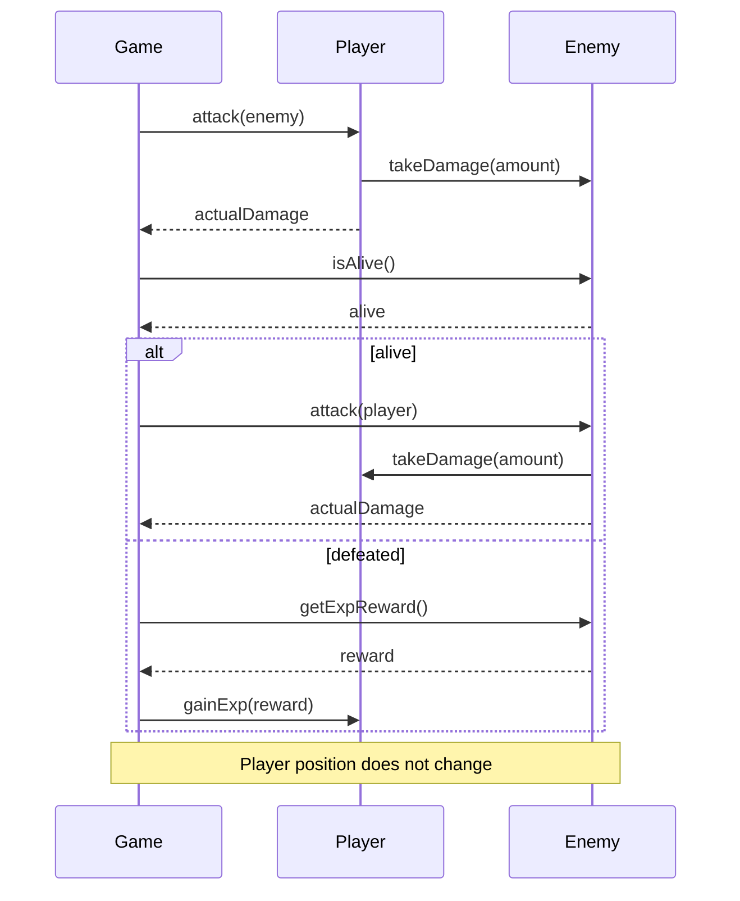

# ความรู้ที่ใช้

## Java และ OOP

| แนวคิด | ใช้กับโปรเจกต์ |
|---|---|
| Class / Object / Constructor | สร้าง Player, Enemy, Item และข้อมูลโลกจากค่าตั้งต้น |
| Encapsulation | เก็บ HP/EXP/กระเป๋าเป็น private เปลี่ยนผ่านเมธอดที่ตรวจเงื่อนไข |
| Inheritance | Weapon, Armor, Potion และ Key สืบทอด Item |
| Overriding / Polymorphism | เรียก getDescription() ผ่าน Item แล้วได้รายละเอียดของชนิดจริง |
| Array / อาร์เรย์สองมิติ | เก็บช่องด่านและประกอบภาพ ASCII |
| ArrayList / List | เก็บรายการของและให้ส่วนหน้าจออ่านโดยไม่แก้รายการโดยตรง |
| if / switch / Loop | แยกคำสั่ง ตรวจช่อง ตรวจตาย และวนเกณฑ์ EXP |
| Scanner / String | รับคำสั่งทีละบรรทัดและสร้างข้อความหนึ่งเฟรม |
| Association / Multiplicity | Player มี Item หลายชิ้น อาวุธ/เกราะที่สวมอย่างละ 0..1 ชิ้น |

## OOAD และ UML — บท 9–11

- แยกกติกาออกจากวิธีเขียน: “ตีแล้วไม่เดิน” เป็นกติกา ส่วน Game จะเรียกเมธอดใดเป็นการออกแบบ
- ใช้ CRC ระบุหน้าที่และผู้ร่วมงานของแต่ละคลาส เช่น Game ประสาน Player/Enemy ส่วน Player คำนวณพลังของตน
- ใช้ Information Expert ให้คลาสที่มีข้อมูลเหมาะสมรับผิดชอบการคำนวณ
- ใช้ Low Coupling / High Cohesion ให้เปลี่ยนสูตรโจมตีโดยไม่ต้องแก้ renderer
- Class Diagram ต้องตรงกับ field, method, extends และจำนวนออบเจ็กต์ที่ใช้จริง
- การอ้างถึง Item เป็น association ก่อน ไม่ถือว่าเป็น composition เพียงเพราะมี field หรือ List

James ใช้กับ Game/Dungeon/Door/หน้าจอ Jezz ใช้กับ Player/Enemy/Item และอุปกรณ์

## Interaction และ State — บท 12

- Sequence ใช้ไล่ลำดับ Game เรียก Player.attack() แล้วตรวจมอนรอด/ตาย ก่อนเรียกสวนหรือเพิ่ม EXP
- Guard ใช้ตรวจเงื่อนไขก่อนเปลี่ยนข้อมูล เช่น ของอยู่ในกระเป๋าและ HP ยังเพิ่มได้ ก่อนใช้ยา
- Game ใช้ enum ภายในคลาสเพื่อแยก PLAYING, INVENTORY, GAME_OVER และ VICTORY ได้
- Enemy ใช้ isAlive() จาก HP > 0 ไม่ต้องมี state ซ้ำอีกตัว
- การโจมตีเป็นหนึ่ง action แล้วกลับไปรับคำสั่ง ไม่ล็อกผู้เล่นอยู่ในโหมดต่อสู้



## Workflow และ Architecture — บท 13

```text
Main: สร้างและเชื่อมออบเจ็กต์
Game: คุมลำดับคำสั่งและสถานะเกม
TerminalDisplay / AsciiRenderer: รับข้อมูลและแสดงผล
Player / Enemy / Item / โลกเกม: เก็บข้อมูลและทำหน้าที่ของแต่ละคลาส
```

Game เรียกข้อมูลและกติกา ส่วน Player/Enemy/Item ไม่รับ Scanner หรือพิมพ์หน้าจอเอง Renderer ไม่หัก HP หรือเพิ่ม EXP ใช้ Activity Diagram เมื่อต้องไล่ทางเลือกของ W และ Inventory โดยแสดงหน้าที่ของคลาสให้ตรงกับโค้ด

## Design Patterns — บท 14

เริ่มจาก constructor, field, enum และ guard ที่ตรงไปตรงมา แล้วเลือก pattern เมื่อมีปัญหารองรับ:

| Pattern | เมื่อใดจึงค่อยใช้ |
|---|---|
| Static factory | สร้างของชนิดเดิมด้วยค่าซ้ำหลายจุด |
| Strategy | มีสูตรหรือพฤติกรรมหลายแบบที่ต้องสลับจริง |
| Observer | หนึ่งเหตุการณ์ต้องแจ้งหลายระบบที่แยกกัน |
| Decorator | มีโบนัสหรือพฤติกรรมที่ต้องซ้อนหลายชั้น |
| State | แต่ละสถานะทำงานต่างกันมากจน enum/guard อ่านยาก |
| Adapter / Composite / Template Method / Builder | เพิ่มเมื่อเกิดโจทย์ของ pattern นั้นในระบบ |

กติกาปัจจุบันใช้ดาบ/เกราะเพิ่มค่าพลังโดยตรงได้ ไม่จำเป็นต้องเพิ่มคลาสเพื่อใส่ pattern ให้ครบ

## ส่วนที่ต้องทดลองเพิ่ม

ภาพ First Person, แสงเงา ASCII, ANSI cursor และสัดส่วนฟอนต์เป็นงานทดลองของ James เริ่มจากภาพระยะใกล้/กลาง/ไกลก่อน การรับปุ่มแบบทันที Threads, Network และ Database ไม่อยู่ในงานรุ่นแรก
